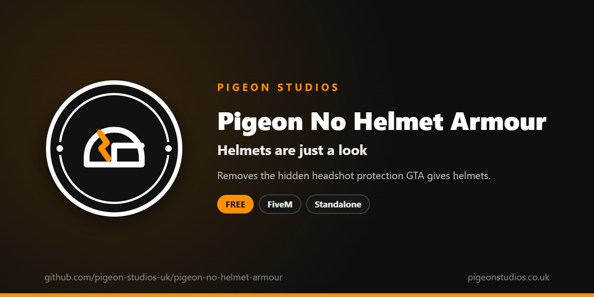

<div align="center">
  

  <h1>Pigeon No Helmet Armour</h1>

  <p><strong>Removes the hidden headshot protection GTA gives helmets, so a helmet is only a look.</strong></p>

  <p>
    <a href="https://github.com/pigeon-studios-uk/pigeon-no-helmet-armour/releases/latest"></a>
    <a href="LICENSE.md"></a>
    <a href="https://discord.gg/2NFVWEUmDF"></a>
    
  </p>

  <p>
    <a href="https://github.com/pigeon-studios-uk/pigeon-no-helmet-armour/releases/latest"><strong>Download</strong></a> ·
    <a href="#installation">Install</a> ·
    <a href="#configuration">Configure</a> ·
    <a href="CHANGELOG.md">Changelog</a> ·
    <a href="https://discord.gg/2NFVWEUmDF">Support</a>
  </p>
</div>

---

## Contents

- [Overview](#overview)
- [Features](#features)
- [Requirements](#requirements)
- [Installation](#installation)
- [Updating](#updating)
- [Configuration](#configuration)
- [How it works](#how-it-works)
- [Update checker](#update-checker)
- [Performance](#performance)
- [Security](#security)
- [Troubleshooting](#troubleshooting)
- [FAQ](#faq)
- [Support](#support)
- [Contributing](#contributing)
- [Licence](#licence)
- [Credits](#credits)

## Overview

Pigeon No Helmet Armour is a free resource by [Pigeon Studios](https://pigeonstudios.co.uk) that takes away the protection GTA quietly gives to anyone wearing a helmet. In GTA, a character with a helmet on shrugs off headshots that would otherwise drop them, and nothing on screen tells players it's happening.

That protection comes from the helmet prop the character wears, so it also applies to many helmets in clothing packs, which reuse GTA's helmet props. On roleplay servers, where a helmet is usually part of an outfit rather than a piece of armour, it makes gunfights hard to predict and rarely matches the server's rules.

With this resource, helmets only change how a character looks. Body armour isn't affected.

## Features

- **Helmets are cosmetic.** No hidden headshot protection from any helmet, GTA's or a clothing pack's.
- **Body armour untouched.** Armour from vests and armour items works as normal.
- **Every player.** Applied to each player's own character, so it covers everyone on the server.
- **Survives respawns and model changes.** Applied again straight away when a player respawns, and every second in case their character changes some other way.
- **Undoes itself.** Stopping the resource gives helmets their protection back.
- **Standalone.** No framework or other resources needed.

## Requirements

| Requirement | Version | Notes |
|---|---|---|
| FXServer | A [recommended artifact](https://runtime.fivem.net/artifacts/) | |

**Frameworks:** none needed. It works the same on standalone servers, ESX Legacy, QBCore, Qbox and ox_core.

## Installation

1. **Download** `pigeon-no-helmet-armour.zip` from the [latest release](https://github.com/pigeon-studios-uk/pigeon-no-helmet-armour/releases/latest). Don't use the green **Code** button; release zips are the tested builds.
2. **Extract** it into your server's `resources` folder. The folder must be called `pigeon-no-helmet-armour`.
3. **Start it** by adding this to `server.cfg`:

   ```cfg
   ensure pigeon-no-helmet-armour
   ```

4. **Restart** your server. The console shows one line from the update checker:

   ```text
   [Pigeon Studios] Pigeon No Helmet Armour v1.0.0 is up to date.
   ```

There's nothing to set up. The one setting is in `configuration/config.lua`.

## Updating

1. Read the [changelog](CHANGELOG.md) for every version between yours and the latest, especially any **Upgrade notes**.
2. Replace the `pigeon-no-helmet-armour` folder with the new release, keeping any change you made to `configuration/config.lua`.
3. Restart the resource.

## Configuration

| Setting | Default | What it does |
|---|---|---|
| `Config.ReapplySeconds` | `1.0` | How often the setting is applied again, for characters that change without a respawn |

## How it works

GTA has a per-character setting, ped config flag 438 (`DisableHelmetArmor`), that switches off the headshot protection a worn helmet gives. The resource turns it on for each player's own character, and changes no other setting.

A character's flags reset when the character is replaced, which happens when a player respawns, changes model or has their appearance reset by some clothing resources. The flag is set again straight away on respawn, and every `Config.ReapplySeconds` for anything else.

When the resource stops, the flag is turned off again, and helmets protect as they did before.

## Update checker

When it starts, Pigeon No Helmet Armour checks our public [version registry](https://github.com/pigeon-studios-uk/pigeon-versions) once and prints one line in the server console saying whether it's up to date. If there's an update, it shows what's new and where to get it. The check is a single request to GitHub and sends nothing about your server or players.

Control it for every Pigeon Studios resource at once in `server.cfg`:

```cfg
set pigeon_update_check "on"      # default: one line per resource
set pigeon_update_check "quiet"   # only when there's an update or a problem
set pigeon_update_check "off"     # never check
```

## Performance

It sets one flag once a second and does nothing else. Nothing runs every frame, and nothing runs on the server apart from the update check at start-up.

## Security

- It runs only in each player's own game and only changes that player's own character. Other players and NPCs are never touched.
- It has no commands, exports or network events, so there is nothing other players, other resources or the server can send it.
- The only network request is the update check at start-up, from the server to GitHub. It sends nothing about your server or players.
- Like every rule that runs in the player's game, a player with a modified game could get around it. It changes how GTA treats helmets; it isn't an anti-cheat.

Found a problem? Please don't open a public issue. Use the **Report a vulnerability** button in this repository's **Security** tab, or follow our [Security Policy](https://github.com/pigeon-studios-uk/.github/blob/main/SECURITY.md).

## Troubleshooting

**Helmets still seem to stop headshots.**
Check the resource is started and there are no errors in the F8 console. Some resources change weapon damage or give players extra health; this resource only removes the helmet's own protection. Body armour still absorbs damage as normal.

**The console says "isn't in the version registry" or "couldn't check for updates".**
Your server couldn't reach GitHub, or the check is blocked by a firewall. The resource works normally either way. Turn the check off with `set pigeon_update_check "off"`.

## FAQ

**Is it really free?**
Yes. Use it on as many servers as you like, including ones that take donations. You just can't reupload, resell or bundle it. See [Licence](#licence).

**Does it affect NPCs?**
No. Only players' own characters are changed.

**Does it change body armour?**
No. Armour works exactly as before.

**Does it stop GTA putting helmets on players?**
No. For that, see [Pigeon No Auto Helmet](https://github.com/pigeon-studios-uk/pigeon-no-auto-helmet).

## Support

Read [Troubleshooting](#troubleshooting) first, then ask in the support channels of our [Discord](https://discord.gg/2NFVWEUmDF). Please include your Pigeon No Helmet Armour version, FXServer artifact and any errors from the console. See [Getting help](https://github.com/pigeon-studios-uk/.github/blob/main/SUPPORT.md).

Found a bug? Open a [bug report](https://github.com/pigeon-studios-uk/pigeon-no-helmet-armour/issues/new/choose).

## Contributing

Fixes and improvements are welcome. Please read the [contributing guide](https://github.com/pigeon-studios-uk/.github/blob/main/CONTRIBUTING.md) first, and open a feature request before working on anything big.

## Licence

Pigeon No Helmet Armour is free to use under the **[Pigeon Studios Free Licence](LICENSE.md)**.

- ✅ Use it on any number of servers, including monetised ones
- ✅ Change it for your own servers
- ✅ Show it in videos and streams
- ❌ Don't reupload, share or mirror the files; link to this repository instead
- ❌ Don't sell it, bundle it in packs, or put it behind escrow
- ❌ Don't remove the credits

This summary isn't the licence; [LICENSE.md](LICENSE.md) is. Third-party notices are in [NOTICE.md](NOTICE.md).

## Credits

Made by [Pigeon Studios](https://pigeonstudios.co.uk).

<sub>Not affiliated with or endorsed by Rockstar Games, Take-Two Interactive or Cfx.re.</sub>
